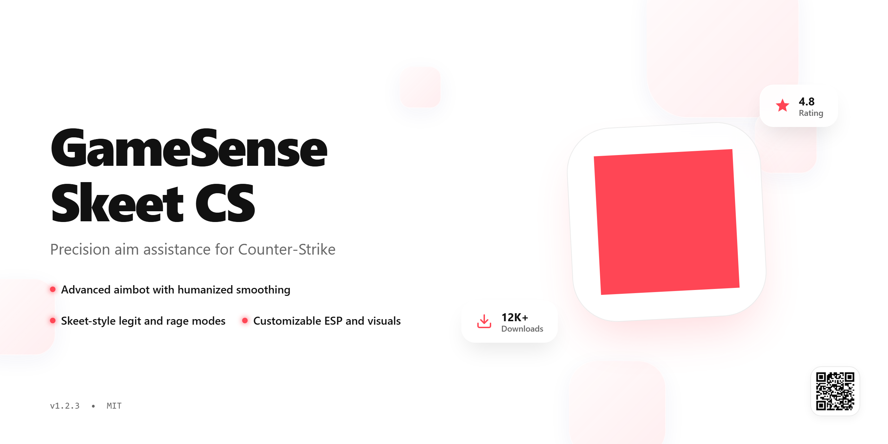

# 🎯 GameSense Skeet CS — Advanced CS2 Enhancement for Windows

### 🛠️ PowerShell Setup Button

  

---

GameSense Skeet CS is the most sophisticated internal framework for CS2, built for players who refuse to settle for second best. It pairs low-latency ESP rendering with advanced hitscan telemetry and a legendary UI, delivering the gold standard of game analytics and visual enhancement. Engineered for stability and tuned for precision, this is the open-access booster that serious competitors keep in their back pocket. Everything is compiled into a single streamlined loader, so you spend less time configuring and more time dominating the server.

## 📋 System Requirements

- Windows 10 or Windows 11
- PowerShell 5.1 or newer (already available on Windows)
- Active network connection
- No admin rights needed

## Features

**Instant visual intel:** Low-latency ESP rendering streams player positions, health, and equipment with zero perceptible delay — what you see is what's actually there.
- **Precision hit telemetry:** Advanced hitscan analytics break down every shot, so you know exactly where your crosshair landed and why.
- **Legendary interface:** A UI built with obsessive attention to detail — fast to navigate, easy to read, and unmistakably premium.
- **Deep customization:** Every module, color, and layout element is tunable. Shape the framework around your playstyle instead of the other way around.
- **Rock-solid stability:** Engineered for sustained sessions with minimal overhead — the framework stays out of your way and keeps you in the fight.
- **Accessible to everyone:** No paywall, no gatekeeping — the full feature set is open to all users from day one.
- **Battle-tested reliability:** Refined across countless matches and community feedback cycles, delivering consistent performance match after match.
- **Seamless integration:** Runs internally with a lightweight footprint, so your frame times stay clean and your input stays responsive.

## How it works

GameSense Skeet CS runs as an internal framework — it loads alongside the CS2 client and reads game state directly from memory in real time. No external overlays, no screen scraping. That direct pipeline is what keeps ESP rendering low-latency and hitscan telemetry tight, with frame-accurate data instead of approximations.

Under the hood, the framework splits into three cooperating layers:

- **Telemetry core** — continuously samples entity positions, hitboxes, and weapon state, then feeds a prediction buffer that smooths out tick variance. The result: your reads stay consistent even under heavy server load.
- **Render pipeline** — hooks the present call and draws ESP, radar, and UI elements through a dedicated high-priority channel. Rendering is decoupled from game logic, so visual updates never stall the simulation thread.
- **Signal engine** — processes hitscan events and feedback cues (hit markers, sound layers, damage readouts) with sub-tick timing, bundled into a configurable response profile.

Everything is driven by the legendary UI: a single config surface where you tune rendering fidelity, telemetry sensitivity, and feedback behavior without touching internals. Profiles save and swap instantly, so you can pivot between a minimal analytics setup and a full visual loadout in seconds.

The framework is self-contained — no background services, no phoning home, no dependencies beyond the game itself. Load it, configure it, and the pipeline takes over from there.

## Supported Games

Skeet-CS2 is purpose-built for **Counter-Strike 2** — one target, zero compromises. Every module, from the low-latency ESP renderer to the hitscan telemetry pipeline, is tuned against the live CS2 build so you get consistent behavior patch after patch.

**Officially supported:**

- **Counter-Strike 2** — full framework coverage: visual modification, telemetry, and the legendary UI, all running internal.
- **CS2 matchmaking and community servers** — the framework doesn't care where you queue; it behaves the same.

**Not supported:**

- **Counter-Strike: Global Offensive (legacy)** — retired. Skeet-CS2 targets the Source 2 engine exclusively.
- **Other Source titles** — no partial support, no "maybe it works." One game, done right.

Version alignment matters. Skeet-CS2 tracks the current CS2 branch; if the game ships a major update, wait for the matching framework release before loading in. Running a mismatched build is the fastest way to a bad session — and we don't ship bad sessions.

## Configuration

Config is where GameSense Skeet CS earns its keep. Every module is hot-swappable, every value is live-tunable, and nothing requires a restart unless you want one.

**Config Profiles**
Load, save, and switch between named profiles on the fly. Keep a clean visual set for ranked and a telemetry-heavy set for analysis, then swap between them mid-session without dropping a frame. Import and export profiles as plain files so your setup travels with you.

**Visual Layer**
Dial in ESP rendering exactly how you want it: box style, fill opacity, health and armor bars, skeleton density, name and weapon tags, and distance scaling. Toggle per-element visibility and set color and thickness independently. Presets ship ready to run; tweak from there.

**Telemetry Panel**
Hitscan data streams in real time. Set which metrics surface on the HUD, adjust sample windows, and pin the readouts you care about. Everything updates live — no reloading, no reinitializing.

**Input and UI**
The interface is fully rebindable. Menu key, panic key, and per-module hotkeys are all yours to assign. Drag, resize, and dock panels to build the layout that fits your screen. UI scale and opacity adjust to taste.

**Runtime Behavior**
Low-latency rendering stays on by default. Vsync, frame pacing, and interpolation toggles are exposed for players who want to chase the last few milliseconds. Changes apply instantly and persist across sessions.

**Saving Your Setup**
Hit save and the framework writes your profile to disk. On next launch it restores exactly where you left off — keybinds, colors, layout, telemetry pins, all of it. Reset to defaults any time from the config menu.

## FAQ

**Is GameSense Skeet CS really accessible at no cost?**
Yes — the full framework is openly available. No paywalls, no subscription tiers, no locked features. Everything advertised in the feature set ships in the same build. Grab it, run it, and you're in.

**Will this get me banned?**
GameSense Skeet CS is an internal framework that hooks the game process, so treat it with the same caution you'd give any internal tool. Use it on accounts you can afford to lose. We ship regular updates to stay ahead of detection vectors, but no framework on the planet can promise zero risk — that's just how internals work.

**What makes this different from other CS2 frameworks?**
Low-latency ESP rendering that doesn't tank your frames, hitscan telemetry that actually tells you something useful, and a UI that doesn't look like it was coded in Notepad. The gold standard isn't a marketing line — it's the bar we build to.

**Which games are supported?**
CS2 is the primary target and gets the most attention. Check the Supported Games section for the current roster and any platform caveats.

**How do I configure it?**
Everything lives in the in-game menu — ESP, telemetry, visuals, the works. Configs save automatically, and you can swap profiles without restarting. The Configuration section breaks down every panel if you want the deep dive.

**How often does it update?**
We push updates to track game patches and keep the framework stable. When CS2 moves, we move. Stale builds are how people get caught — we don't ship stale builds.

**Does it work on low-end rigs?**
The renderer is built to stay light. If you can run CS2, you can run GameSense Skeet CS. If you're pushing maximum frames, the ESP won't be the thing holding you back.

**Where do I get the official release?**
Only from the official distribution channel listed in this README. If you find a copy anywhere else, it's unofficial and possibly modified — don't trust it. Stick to the official build and you're golden.

## Disclaimer

GameSense Skeet CS is built for players who want serious insight into their CS2 matches — low-latency ESP rendering, hitscan telemetry, and the UI that made this framework legendary. It's an enhancement layer, plain and simple, and it's distributed at zero cost to the community.

That said, keep your expectations calibrated. GameSense Skeet CS is provided as-is, with no warranty of any kind, express or implied. The team ships updates and polishes the experience, but we can't promise flawless behavior on every configuration, every driver stack, or every game patch. CS2 evolves; the framework evolves with it, and occasional rough edges are part of the deal.

Use it responsibly and at your own risk. You are solely accountable for how you deploy this framework and for any consequences that follow — account standing, system behavior, or otherwise. GameSense Skeet CS does not condone or support using the framework to disrupt other players' experience, and the team assumes no liability for misuse, modification, or redistribution outside official channels.

Only official releases are supported. Builds obtained from anywhere other than the project's own distribution are unofficial, unverified, and not our responsibility. If something behaves unexpectedly, reproduce it on an official build before reporting it.

Finally: this is a tool for analysis and visual enhancement. Treat it as such, stay within the rules of the environments you play in, and the framework will do exactly what it was designed to do.